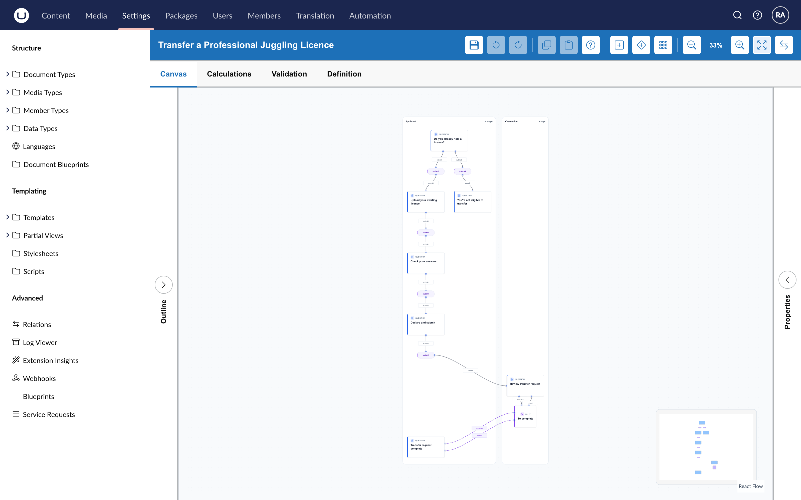
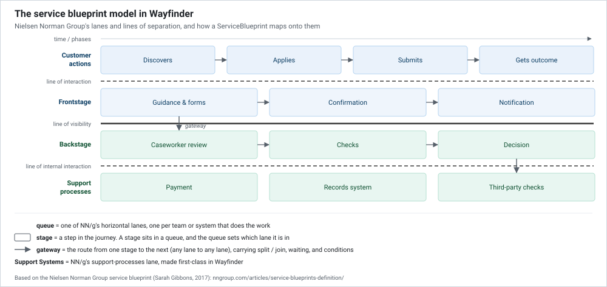
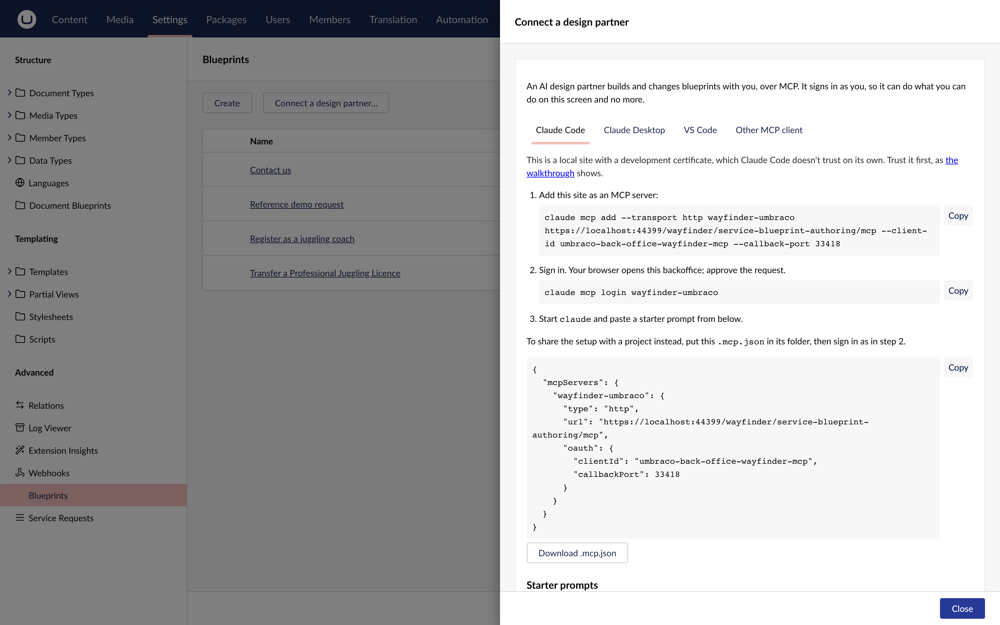
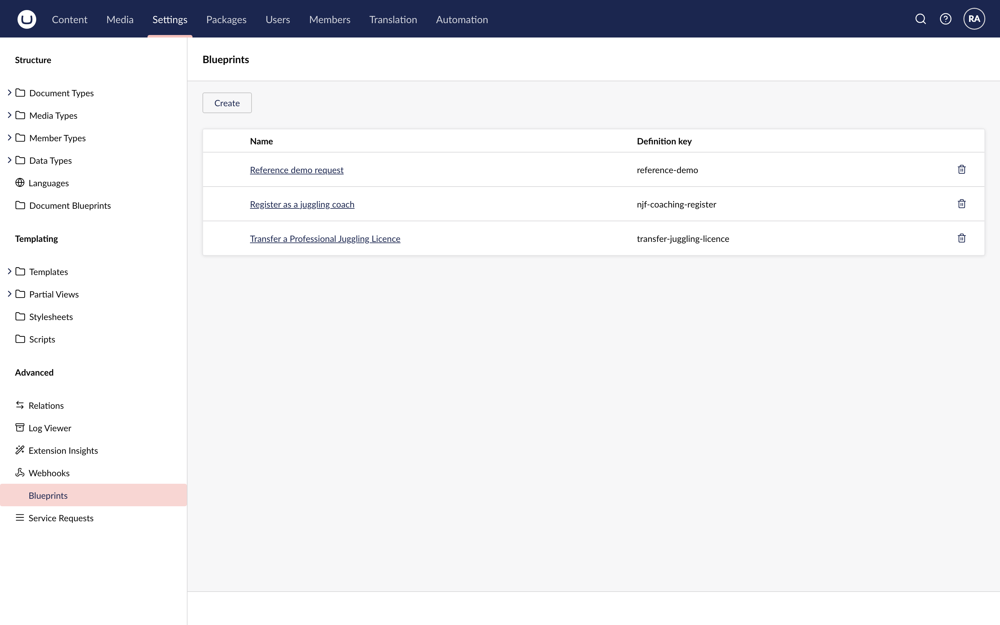
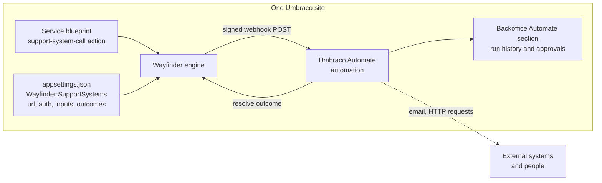
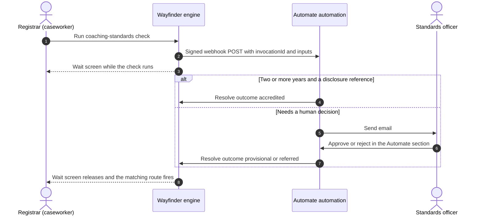
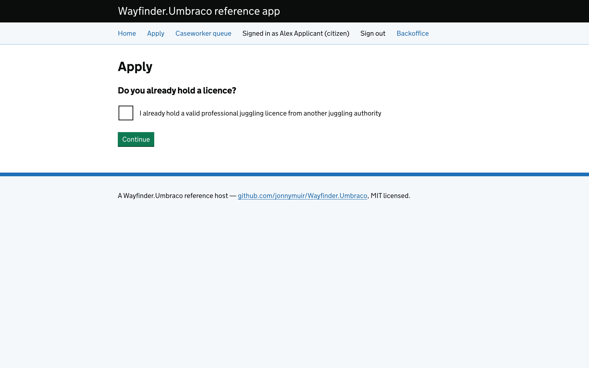
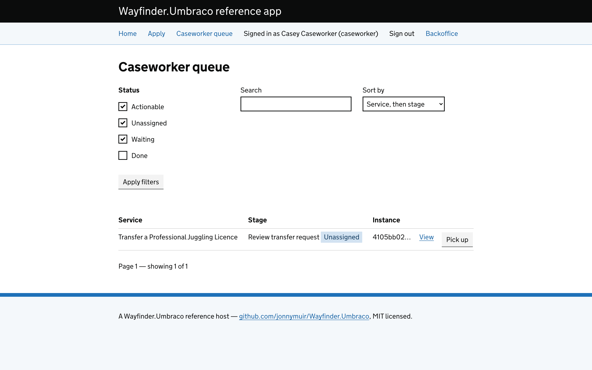
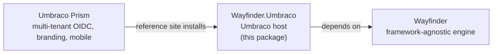

<picture>
  <source media="(prefers-color-scheme: dark)" srcset="assets/wordmark-umbraco-dark.png">
  
</picture>

[](https://github.com/jonnymuir/Wayfinder.Umbraco/actions/workflows/ci.yml)
[](https://www.nuget.org/packages/Wayfinder.Umbraco)
[](LICENSE)

**Wayfinder for Umbraco puts service design into the CMS your team already runs.** Describe a
public-facing service, get a working GOV.UK-styled journey with a caseworker queue behind it, and
compose it onto a page like any other Umbraco content.

It is the Umbraco host for [Wayfinder](https://github.com/jonnymuir/Wayfinder), a service
blueprint and service-design engine.

## Design it. See it. Run it.

| | |
|---|---|
| **Design it** | Author a service blueprint: the stages a person moves through, the decisions between them, and the queues your team works from. Use the visual editor, or design it in conversation with an AI partner over MCP. |
| **See it** | A blueprint is content in Umbraco. Drop the stage block onto a page and it renders as a real GOV.UK journey. Changing the journey is a content change, not a redeploy. |
| **Run it** | The in-process engine routes each request, evaluates the decision points, and holds work in the right queue. The worklist block gives caseworkers pickup, filtering, and paging. |



## Try it in five minutes

The [starter kit](Wayfinder.Umbraco.Starter/README.md) turns a brand new Umbraco site into a working
Wayfinder demo with no code: a home page, a sample service with a public side and a caseworker
queue, a one-click demo caseworker, and the design partner endpoint ready for an AI assistant.

```bash
dotnet new umbraco -n TryWayfinder -r LTS --development-database-type SQLite \
  --friendly-name "Admin" --email admin@example.test --password "ChangeMe123!"
cd TryWayfinder
dotnet add package Wayfinder.Umbraco.Starter
dotnet run
```

Open the address `dotnet run` prints. Send a request on **Request a callback**, then work it from
the **Work queue** as the caseworker. Connect Claude Code with the command on the home page,
describe a service, and try it at `/services/{key}` as soon as it is saved.

The starter is for your own machine only: its caseworker sign-in has no password, so it refuses
to run outside the Development environment. A real site uses the
[Quickstart](#quickstart) instead.

## What it's for

Wayfinder for Umbraco is for teams that design and run public-facing services and have chosen
Umbraco as their platform. It helps you:

- **Turn a service design into something people can use**, without a separate workflow product or a
  bespoke build for every form.
- **Keep the design and the running service in one place**, so a change to the journey is reviewed
  and published the way your team already reviews and publishes content.
- **Give caseworkers a real queue**, on the same access rules and rendering pipeline as the
  citizen-facing side.

It follows established practice rather than inventing its own. The model is the service blueprint
as the [Nielsen Norman Group defines it](https://www.nngroup.com/articles/service-blueprints-definition/)
(Sarah Gibbons, 2017): a user journey laid out across customer actions, frontstage, backstage, and
support processes, divided by the lines of interaction, visibility, and internal interaction. Those
horizontal lanes are the `queues` in a Wayfinder blueprint, each a lane of work owned by a team or
system, which the caseworker worklist block renders. Journeys are built to the
[GDS Service Standard](https://www.gov.uk/service-manual/service-standard), and components rendered
with the real GOV.UK Design System to [WCAG 2.2 AA](https://www.w3.org/TR/WCAG22/).



*The model is the [Nielsen Norman Group service blueprint](https://www.nngroup.com/articles/service-blueprints-definition/)
(Sarah Gibbons, 2017). See the article for Gibbons' own worked example.*

## Design in conversation, over MCP

The visual editor is one way to author a blueprint. The other is to describe the service in plain
language to an AI design partner and have it build the blueprint, then refine it with you.

Wayfinder for Umbraco exposes its authoring tools over the
[Model Context Protocol](https://modelcontextprotocol.io). MCP is an open standard, so the design
partner can be Claude Code or any other agent or harness that speaks it. The agent connects by
logging into the Umbraco backoffice with the standard OAuth flow, so its permissions are the
permissions of the person who authorised it.

The loop stays in domain language throughout:

1. **Describe** the problem, the user need, and the rules, the way you would to a colleague.
2. **Generate**: the agent drafts stages, decision points, uploads, and review steps, and
   validates them against the engine.
3. **Refine**: it asks clarifying questions, you answer in plain terms, it revises. When it saves,
   the blueprint is live in Umbraco.

Then you publish it to a page, open it in the visual editor to see what the words became, and run
it as an applicant and a caseworker.

- **Walkthrough:** [`docs/mcp-authoring-walkthrough.md`](docs/mcp-authoring-walkthrough.md) runs
  the whole cycle step by step against the reference app.
- **Video:** the same walkthrough recorded as one continuous take (see `tests/demo/`).

### Turning on MCP authoring in your own site

The MCP endpoint is opt-in: installing `Wayfinder.Umbraco` alone gives you the visual editor,
not MCP. Add the MCP package:

```bash
dotnet add package Wayfinder.Engine.Mcp
```

Then wire five calls into `Program.cs`. This is the reference app's own wiring
([`Program.cs`](Wayfinder.Umbraco.ReferenceApp/Program.cs)), trimmed to what MCP needs:

```csharp
using Microsoft.AspNetCore.Authorization;
using Umbraco.Cms.Core;
using Wayfinder.Engine.Mcp;
using Wayfinder.Umbraco;
using Wayfinder.Umbraco.Extensions;
using Wayfinder.Umbraco.Mcp;

const string McpEndpointPath = "/wayfinder/service-blueprint-authoring/mcp";

builder.Services.AddServiceBlueprintAuthoringMcp();            // 1. the MCP server

builder.CreateUmbracoBuilder()
    .AddBackOffice()
    .AddWebsite()
    .AddComposers()
    .AddWayfinderUmbracoMcpAuthentication()                    // 2. the backoffice OAuth client
    .Build();

var app = builder.Build();
app.UseWayfinderUmbracoMcpAuthChallenge(McpEndpointPath);      // 3. outermost: adds the RFC 9728 hint to the 401

await app.BootUmbracoAsync();
app.UseUmbraco() /* ...your usual WithMiddleware / WithEndpoints... */;

app.MapServiceBlueprintAuthoringMcp(McpEndpointPath)           // 4. the endpoint, admins only
   .RequireAuthorization(new AuthorizeAttribute
   {
       Policy = WayfinderUmbracoAuthorizationPolicies.BlueprintsAdmin,
       AuthenticationSchemes = $"{Constants.Security.BackOfficeAuthenticationType},OpenIddict.Validation.AspNetCore",
   });
app.MapWayfinderUmbracoMcpOAuthDiscovery(McpEndpointPath);     // 5. the discovery documents
```

- The endpoint is deny-by-default even without step 4. Step 4 narrows it to the same
  `BlueprintsAdmin` policy the backoffice Blueprints screen uses. `AuthenticationSchemes` is
  required: a minimal API mapped outside Umbraco's Management API doesn't inherit the backoffice
  schemes, so without it the endpoint challenges your site's default (front-end) scheme.
- Step 3 must run before `BootUmbracoAsync`, so it wraps the whole pipeline and sees the 401.
- In Development, the loopback callbacks Claude Code (`http://localhost:33418/callback`) and VS
  Code (`http://127.0.0.1:33418/`) use are registered for you. Anywhere else, list your MCP
  client's real callback URLs under `Wayfinder:Mcp:RedirectUris` in `appsettings.json`. Claude
  Desktop and claude.ai use `https://claude.ai/api/mcp/auth_callback`.
- A registered callback on a loopback IP address (`127.0.0.1` or `[::1]`) accepts any port, as
  [RFC 8252](https://www.rfc-editor.org/rfc/rfc8252#section-7.3) requires, because some clients
  listen on a port the operating system picks. GitHub Copilot CLI is one. Everything else about the
  callback must match exactly, and `localhost` callbacks still need their exact port.

### Connecting a design partner

Once MCP authoring is on, **Connect a design partner** on the Blueprints screen gives each designer
the setup for Claude Code, Claude Desktop, VS Code, GitHub Copilot CLI or any other MCP client, with this site's server
URL, client ID and callback port filled in. Each step has a copy button, the Claude Code and VS
Code config files download in one click, and two starter prompts get a conversation going: one to
design a new service, one to work through the design notes on a blueprint. If a client's sign-in
callback isn't registered on this site, the panel says so and shows the setting to add.



The [reference app README](Wayfinder.Umbraco.ReferenceApp/README.md#mcp-service-blueprint-authoring)
shows how to connect Claude Code, including the headless client-credentials option.



## Connect other systems with Umbraco Automate

A service rarely finishes inside one system. In the service blueprint model, the systems a stage
calls out to and waits on are the **support processes** lane: a standards body, an insurer, a
payments provider. Wayfinder models each one as a **support system**, and
[Umbraco Automate](https://docs.umbraco.com/umbraco-automate) is the integration engine behind it.

You register the support system in `appsettings.json` and build the integration as an Automate
automation on the same site. The integration itself needs no C#: the only code is one small
Automate action that hands the outcome back to Wayfinder, which you can copy from the reference
app (see below).



- **Wayfinder calls out.** A stage carries a `support-system-call` action. When the stage opens,
  Wayfinder POSTs a signed invocation to the automation's webhook trigger and parks the request on
  a wait screen. The POST carries the mapped field values and an `invocationId`, and no callback
  URL.
- **Automate does the integration work.** The automation is an ordinary Automate workflow: branch
  on the applicant's data, send an email, call other systems over HTTP, ask a person to approve.
  Its runs and pending approvals are visible in the backoffice Automate section, next to the
  content the service runs on.
- **The outcome comes back.** The automation finishes with one of the outcomes the capability
  declares. The wait screen releases and the matching route fires. Validation rejects a route whose
  trigger is not a declared outcome.

Why this pairing works:

- **One small contract.** A URL, an auth scheme, the inputs and the outcomes, all in configuration.
  Anything that can receive a signed POST satisfies it, so Zapier, Make, n8n or your own service
  work the same way. Automate is the one that needs no extra infrastructure.
- **A human in the loop, out of the box.** A Request Approval step turns "the standards officer
  decides" into a pending approval in the backoffice, and the citizen's journey holds until it is
  answered.
- **Same site, same database, same sign-in.** Automate shares the CMS database, so there is
  nothing else to host, secure or monitor.
- **Signed in both directions.** The outbound request carries an HMAC-SHA256 signature, and an
  outcome can only be delivered against an unguessable `invocationId`.

The reference app's coaching register shows the whole path. Two or more years of experience and a
disclosure reference auto-accredit the applicant. Anything else emails the standards officer and
waits for an approval, where approve means `provisional` and reject means `referred`:



An automation on the same site delivers the outcome in process, through a small custom Automate
action
([`ResolveSupportSystemOutcomeAction`](Wayfinder.Umbraco.ReferenceApp/ResolveSupportSystemOutcomeAction.cs)
in the reference app, ready to copy), because Automate's built-in HTTP Request step blocks
loopback addresses. An automation on another host (or Zapier, Make, n8n) delivers it to
Wayfinder's HTTP callback route instead, which a host maps with
`MapWebhookSupportSystemCallbacks` from the `Wayfinder.Engine.Http` package.

To use Automate you need the `Umbraco.Automate` package (plus its persistence package for your
database) alongside `Wayfinder.Umbraco`; it registers itself through its own composer.

- **Walkthrough:** [`docs/automate-support-system-walkthrough.md`](docs/automate-support-system-walkthrough.md)
  runs it step by step against the reference app.
- **Reference:** the [support systems guide](https://github.com/jonnymuir/Wayfinder/blob/main/docs/guides/support-systems.md)
  covers the configuration, including where the endpoint URL comes from, and writing a custom
  client for systems that need file uploads or polling.

## What you get

Install the package and call `AddWayfinderUmbraco()`:

- **A service blueprint store**, DB-backed (`wayfinderServiceBlueprint`, each blueprint stored as
  YAML) and uSync-portable, with its own package migration so the table and the two building blocks
  are created on install.
- **Two Block Grid blocks**, composable onto any content page like any other block.
  `wayfinderServiceRequestStage` is the citizen-facing journey: GOV.UK components, file upload,
  GetCurrent and Advance. `wayfinderServiceRequestWorklist` is the caseworker queue: pickup and
  putback, filtering, paging, and rendering a picked item inline through the same pipeline the
  stage block uses.
- **A "Blueprints" authoring UI** under Umbraco's built-in Settings section (Advanced group), with
  no host wiring and nothing to grant on startup. The authoring API enforces its own boundary on
  top (`WayfinderAdminHandler`, configurable via `WayfinderServiceDesignOptions.AdminGroupAliases`).
- **The authoritative engine, in process.** Queue routing, decision-point evaluation, and request
  persistence run where Umbraco runs. There is no remote service to proxy to.
- **Multi-queue support.** A blueprint declares as many queues as it needs; each block renders only
  what the signed-in actor's `ActorProfile` can see.
- **A GOV.UK component and field catalog**, overridable one type at a time by placing
  `~/Views/Partials/Components/_Component-{Type}.cshtml` (or `Fields/` for an input field) in your
  own app — e.g. `_Component-SummaryList.cshtml` overrides the `summary-list` component. See
  [Customising how components render](docs/customising-rendering.md).
- **Support systems, integrated through Umbraco Automate.** Register an external system in
  `appsettings.json`, build the integration as an automation on the same site, and a stage can call
  it and wait for its outcome. See [Connect other systems with Umbraco Automate](#connect-other-systems-with-umbraco-automate).
- **The signed-in user, as a blueprint value.** Declare a `source: "service"` calculation field
  named `user` and any input can pre-fill from the signed-in user with `defaultFrom`, with no host
  code. `user.name` comes from the `name` claim and `user.email` from the `email` claim, and both
  are empty for an anonymous visitor. A saved answer always wins over the default:

  ```yaml
  calculations:
    fields:
      user:
        source: service
        shape:
          name:
            valueKind: string
          email:
            valueKind: string
  # ...and on a stage:
  components:
    - type: text
      fieldKey: applicantName
      label: Full name
      defaultFrom: user.name
    - type: email
      fieldKey: applicantEmail
      label: Email address
      defaultFrom: user.email
  ```

  A registered `IServiceInputsResolver` that supplies its own `user` value takes precedence.
- **An audit trail**, DB-backed (`wayfinderAuditEvent`): every transition, pickup and putback,
  with who did it and when, read back through `IAuditLogStore`. Events are removed once they
  are older than `Wayfinder:AuditRetention` (365 days by default; `00:00:00` keeps them forever).
- **Request storage**, DB-backed (`wayfinderServiceRequest`). An anonymous visitor's request expires
  thirty minutes after they last touched it while it is still a draft in their own queue. Once it
  has been handed over to another queue (a submission landing in a team's worklist), or belongs to
  a signed-in member, it is kept until something removes it, so your retention policy needs to
  cover it.
- **The supporting infrastructure**: nonce handling, file upload, field validation, and live
  workflow-state polling, so a waiting or join-gateway screen updates in place instead of needing a
  manual refresh.
- **Times in your visitors' time zone.** Set `Wayfinder:DisplayTimeZone` (an IANA id such as
  `Europe/London`) and conversation messages and dates show in it, GMT or BST as the date falls.
  Everything is still stored in UTC; host views can inject `WayfinderDisplayTime` for their own.
- **A worklist you can restyle.** The worklist block's list and its open-item page render through
  `~/Views/Partials/_WayfinderWorklist.cshtml` and `_WayfinderWorklistItem.cshtml`. Put your own
  copy in your site to show the queue your way; the model carries each item with its request's
  field values, and the item and pickup URLs. To put the worklist on a page of your own (a
  controller view behind your own authorization, say), render
  `@await Html.PartialAsync("~/Views/Partials/_WayfinderWorklistForPage.cshtml", 20)` (the page size).





## Quickstart

```bash
dotnet add package Wayfinder.Umbraco
```

That's it for the Blueprints authoring UI — boot the site and go to **Settings → Advanced →
Blueprints**. To make a real citizen/caseworker journey work (rather than the safe
no-real-access defaults below), wire up your own identity model too:

```csharp
// YourSiteComposer.cs
public class YourSiteComposer : IComposer
{
    public void Compose(IUmbracoBuilder builder)
    {
        builder.Services.AddWayfinderUmbraco(options =>
        {
            options.ResolveTenantId      = _ => "default";               // single-tenant
            options.ResolveAccessProfile = (ctx, blueprintKey) => YourQueues.AccessProfileAsync(ctx, blueprintKey);
            // ResolveUserId defaults to the NameIdentifier claim. Override it only with another
            // stable, unforgeable id, never a display name the person can change.
        });
    }
}
```

`ResolveAccessProfile` is asynchronous and receives the blueprint key being rendered (`null` for
a worklist that spans blueprints), so a host can scope access per service. It runs on every stage
render and form post, so cache any lookup it makes.

Then drop the `wayfinderServiceRequestStage` block onto any Block Grid page and set its
`blueprintKey`. To render a journey from your own block or template instead, use the same view the
block does:

```cshtml
@await Html.PartialAsync("~/Views/Partials/_WayfinderStageForBlueprint.cshtml", "your-blueprint-key")
```

## A contact page, without anyone signing in

A contact page is a conversation: the visitor writes, the team replies, either can carry on. The
reference app's [`contact-us.yaml`](Wayfinder.Umbraco.ReferenceApp/service-blueprints/contact-us.yaml)
is a complete blueprint for one (a `conversation` component, and a split and join so the visitor
waits while the team replies). Four optional pieces make it work for visitors who never sign in:

```csharp
builder.Services.AddWayfinderUmbraco(options =>
{
    options.ResolveAccessProfile = YourQueues.AccessProfileAsync;   // the team, or a visitor
    options.DisplayTimeZone = "Europe/London";
});

// Anonymous visitors: a browser cookie, with a private link in each email to come back on any device.
builder.Services.AddWayfinderVisitors(visitors =>
{
    visitors.StaffLandingPath = "/messages/";      // where a team member who opens a link is sent
    visitors.ExpiredLinkPath = "/contact-us/";
});

// Opening the page picks up the visitor's latest conversation, whatever state it's in.
builder.Services.AddSingleton<IRequestConcurrencyPolicy>(new LatestRequestPolicy("contact-us"));

// Emails as conversations move on, through Umbraco's own SMTP settings, in the background.
builder.AddWayfinderEmails(emails =>
{
    emails.From = "Your site <noreply@example.com>";
    emails.PublicBaseUrl = "https://example.com";
    emails.Emails.Add(new() { Name = "reply", BlueprintKey = "contact-us", Actions = ["reply", "close"],
        Subject = "We've replied to your message", Template = "~/Views/Emails/ContactReply.cshtml",
        ToField = "email", PrivateLinkPagePath = "/contact-us/" });
    emails.Emails.Add(new() { Name = "team-notice", BlueprintKey = "contact-us", Actions = ["send"],
        Subject = "New message on the contact page", Template = "~/Views/Emails/ContactTeamNotice.cshtml",
        ToAddresses = ["team@example.com"] });
});

// Bot protection with Google reCAPTCHA v3; it fails closed.
builder.Services.AddWayfinderRecaptcha(recaptcha =>
{
    recaptcha.SiteKey = config["ReCaptcha:SiteKey"]!;
    recaptcha.SecretKey = config["ReCaptcha:SecretKey"]!;
});
```

The team answers from an ordinary content page with the worklist block on it, protected the way
your site protects any members' page (Umbraco's Public Access, say). How it behaves:

- **A visitor** is a random 256-bit secret in an HttpOnly, Secure cookie. Their requests record a
  one-way hash of it as their owner, never the secret, so nothing shown or stored (a worklist, the
  audit log, a backup) is a way to act as them.
- **A private link** in an email works for 30 days (`Wayfinder:Visitors:PrivateLinkLifetime`).
  Following one changes nothing by itself: the page asks "Continue in this browser?", and only that
  answer, posted from your own page, adds the browser to the visitor, with a secret of its own. A
  link someone else sends you can't quietly make your browser theirs. Only a hash of each link is
  stored.
- **Signing in** moves what a visitor started onto their account, the next time a stage renders
  for them. A team member (an access profile not limited to their own requests) never takes
  over a visitor's requests, whether by signing in or by opening a link.
- **Emails** are Razor views with a `WayfinderEmailModel`; a conversation is quoted as it was when
  the move happened. Queued jobs carry ids only, never a name, address or message. They send on
  Umbraco's background queue; register your own `IWayfinderEmailQueue` (a Hangfire job calling
  `WayfinderEmailSender.SendAsync`) for retries that survive a restart.

Members are identified by Umbraco's members' scheme (`Identity.Application`) as `member:{id}`; a
site with its own sign-in sets `WayfinderVisitorOptions.SignedInUserId`.

## What a host still owns

Wayfinder for Umbraco has no multi-tenancy or auth opinion of its own. A host wires:

- **Identity and tenancy**, via `WayfinderServiceDesignOptions.ResolveTenantId` / `ResolveUserId` /
  `ResolveAccessProfile`. The defaults are safe so a bare package reference boots: a fixed
  `"default"` tenant, the user id from the `NameIdentifier` claim, and an `ActorProfile` that can
  view, start and act on no real queue. Override `ResolveAccessProfile` (and the tenant, if you
  have more than one) for citizen and caseworker journeys to actually work.
- **The polling policy, only if the default doesn't fit.** The live-update endpoint
  (`ServiceRequestPollController`) sits behind the
  `WayfinderUmbracoAuthorizationPolicies.ServiceRequestPolling` named policy; the package registers
  a default (`RequireAuthenticatedUser()`) so a bare package reference works out of the box. A
  host only needs its own `Configure<AuthorizationOptions>` call (in its own composer) to require a
  specific authentication scheme instead.
- **Engine extensions, only if a service needs them.** Register these next to
  `AddWayfinderUmbraco()` and the engine picks them up. A host never constructs the engine itself.

  | Register | To |
  |---|---|
  | `IServiceInputsResolver` | Supply `source: "service"` calculation fields from your own systems. A field you don't supply keeps its stored value. |
  | `IRequestConcurrencyPolicy` | Decide whether someone can start another request for a blueprint, for example one open claim per person. |
  | `IAuditLogStore` | Keep the audit trail somewhere else. Your store replaces the database one, and its retention is then yours. |
  | `ServiceRequestTransitionedNotification` handler | React when a request moves stage (send an email when a reply reaches the citizen, say), with `builder.AddNotificationAsyncHandler<ServiceRequestTransitionedNotification, YourHandler>()`. Published once per saved move, whatever caused it; a handler that throws is logged and never undoes the move. |
  | `IStageSubmissionGuard` | Check every stage submission before anything changes: bot protection (a CAPTCHA, a honeypot), rate limiting. Its fields are added to every stage form, and a rejection returns the person to the stage with your message. Register as many as you need. |

## Security responsibilities

What the package protects itself, and what a host must add. Every route below is the package's
own unless it says otherwise.

| Surface | Route | Protected by |
|---|---|---|
| Backoffice authoring API (`ServiceBlueprintAuthoringController`) | Umbraco Management API, `/umbraco/management/api/v1/wayfinder/...` | The `WayfinderUmbracoAuthorizationPolicies.BlueprintsAdmin` policy, registered by the package and checked against `WayfinderServiceDesignOptions.AdminGroupAliases`. |
| Live-update polling (`ServiceRequestPollController`) | `/api/wayfinder/workflow/poll` | The `WayfinderUmbracoAuthorizationPolicies.ServiceRequestPolling` policy. The package's default is `RequireAuthenticatedUser()`, or, with `AddWayfinderVisitors`, open to visitors too; either way the engine answers only about a request the caller's own id may see. A host can replace it (see above). |
| Private links (`WayfinderPrivateLinkController`, only with `AddWayfinderVisitors`) | `/wayfinder/link` | `[AllowAnonymous]` deliberately: the 256-bit token is the proof, and only its hash is stored. Following a link (GET) changes no identity; the answer (POST) is antiforgery-checked. Responses are `no-store`, `no-referrer` and never framed. A request owned by a signed-in person opens only for them, and a team member is sent to `StaffLandingPath` unchanged. |
| Stage form posts (`WayfinderStageSurfaceController`) | Umbraco surface controller | Antiforgery validation, a per-instance nonce, and the engine's ownership check. Uploaded files arrive with this form post. Anonymous journeys accept posts from anyone, so register an `IStageSubmissionGuard` for bot protection; it runs only once the nonce is verified. |
| Uploaded-file downloads and bulk-data-review data (`WayfinderStageDataController`) | `/umbraco/wayfinder-stage/{blueprintKey}/{instanceId}/...` | The engine's ownership check (`IsOwnedInstance`) against the caller's host-resolved identity, on every action. It carries `[AllowAnonymous]` deliberately, so an anonymous citizen journey still works; the ownership check is the boundary. |
| MCP authoring endpoint (only if you turn it on) | Wherever you map it | Deny-by-default in `Wayfinder.Engine.Mcp`; narrow it to `BlueprintsAdmin` as shown in [Turning on MCP authoring](#turning-on-mcp-authoring-in-your-own-site). |

Because the ownership check runs against the identity *your* resolvers return, the resolvers
are part of the security boundary. `ResolveUserId` must return a stable, unforgeable id for the
signed-in person (not a display name they can change), and `ResolveAccessProfile` must only grant
the queues that person may work.

### If you add progressive file uploads

The `file-upload` component also renders markup for an asynchronous, progress-bar upload. The
package doesn't ship the script or the endpoints for it: a host that wants it (Umbraco Prism's
reference site does) adds its own script and mounts upload and download controllers under
`WayfinderServiceDesignOptions.FileEndpointBasePath` (default `/service-request`). Each of those
controllers must verify the caller owns the instance before reading or writing anything:

```csharp
if (!engine.IsOwnedInstance(instanceId, tenantId, userId, accessProfile))
{
    return NotFound();
}
```

Skipping this check is an IDOR: anyone who knows or guesses an `instanceId` could upload to, or
download from, another citizen's application. Umbraco Prism's
[`PublicServiceRequestFileUploadController`](https://github.com/jonnymuir/Umbraco.Prism/blob/main/src/UmbracoPrism.TestSite/Controllers/PublicServiceRequestFileUploadController.cs)
shows the full pattern, including nonce validation.

To report a vulnerability, see [SECURITY.md](SECURITY.md).

## Reference app

[`Wayfinder.Umbraco.ReferenceApp`](Wayfinder.Umbraco.ReferenceApp/README.md) is a real, bootable
Umbraco 17 site that runs this package end to end: the citizen stage block, the caseworker
worklist, pickup and putback, access control, the Automate-driven support system, and the MCP
authoring surface. Backoffice and demo logins are documented there.

`Wayfinder.Umbraco.StarterSite` is the other sample: a stock `dotnet new umbraco` site, with the
template's own [`Program.cs`](Wayfinder.Umbraco.StarterSite/Program.cs), whose only change is the
starter kit reference. The starter's integration tests boot it to prove the
[five-minute path](#try-it-in-five-minutes) works.

## Requirements and compatibility

| | |
|---|---|
| **Umbraco** | 17.x (17.7.0 or later). The package targets one Umbraco major at a time, and restore fails on Umbraco 18 rather than loading against an untested API. |
| **.NET** | 10 |
| **Database** | SQL Server or SQLite, whichever the site uses. CI runs the integration suite against both. |
| **uSync** | 17.x (17.4.2 or later), for blueprint export and import |
| **Umbraco Automate** | Optional, 17.x, for [support systems](#connect-other-systems-with-umbraco-automate) |

Wayfinder.Umbraco 6.1.0 depends on these Wayfinder packages, installed for you:

| Package | Version | What it provides |
|---|---|---|
| `Wayfinder` | 0.25.0 | The domain model and calculation engine. |
| `Wayfinder.Engine` | 0.25.0 | The state-machine engine. |
| `Wayfinder.Rendering.GovUk` | 0.12.0 | GOV.UK Design System rendering and the component catalog. |
| `Wayfinder.Editor` | 0.11.0 | The visual editor behind **Settings → Advanced → Blueprints**. |
| `Wayfinder.Engine.Worklist` | 0.5.0 | The caseworker worklist rendering. |

Two more are optional and added by the host: `Wayfinder.Engine.Mcp` for
[MCP authoring](#turning-on-mcp-authoring-in-your-own-site), and `Wayfinder.Engine.Http` for an
out-of-process support system's callback route. Use the same Wayfinder version line as the table
above. The [changelog](CHANGELOG.md) lists what changed in each release and how to upgrade.

## How it fits together



Each arrow points from a project to the one it builds on.

- **[`Wayfinder`](https://github.com/jonnymuir/Wayfinder)** is the framework-agnostic core: the
  domain model, the calculation engine, the state-machine engine, GOV.UK rendering and the visual
  editor. No Umbraco, no hosting assumptions. Its
  [glossary](https://github.com/jonnymuir/Wayfinder/blob/main/docs/glossary.md) maps the NN/g
  terms to the ones used here.
- **`Wayfinder.Umbraco`** (this package) is the Umbraco host: the database-backed store, the
  blocks, and the backoffice authoring UI.
- **[Umbraco Prism](https://github.com/jonnymuir/Umbraco.Prism)** adds multi-tenancy, branding and
  mobile to Umbraco. `UmbracoPrism.Core` has no Wayfinder dependency; only its reference site
  installs this package, the way any other site would.

All three publish to nuget.org only.

## Building

You need the .NET 10 SDK and Node 20+. The backoffice bundles are packed as static web assets, so
build them before `dotnet build`:

```bash
cd Wayfinder.Umbraco.Client && npm ci && npm run build && cd ..
dotnet build Wayfinder.Umbraco.slnx -c Release
dotnet test  Wayfinder.Umbraco.slnx -c Release --no-build
dotnet pack  Wayfinder.Umbraco.slnx -c Release --no-build -o ./artifacts
```

## Contributing and security

Changes reach `main` through pull requests with [Conventional Commits](https://www.conventionalcommits.org/)
titles; [`CLAUDE.md`](CLAUDE.md) holds the full conventions. To report a vulnerability, use
[GitHub's private reporting](https://github.com/jonnymuir/Wayfinder.Umbraco/security/advisories/new)
as described in [SECURITY.md](SECURITY.md), not a public issue.

## License

MIT, see [LICENSE](LICENSE).
