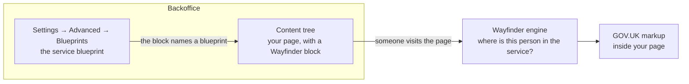
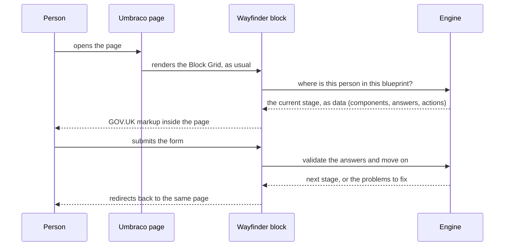

# How Wayfinder works in Umbraco

Wayfinder for Umbraco lets a team design a public service and publish it on their Umbraco site
the way they publish anything else. This page explains how the pieces fit together, for two kinds
of reader:

- **If you know Umbraco**, it should feel familiar: a package that adds a screen under Settings, a
  couple of Block Grid blocks, Razor partials you can override, and services you register in a
  composer.
- **If you know service design**, it shows where your blueprint lives, how it reaches a real page,
  and which parts you, or your developers, can change.

It tells the story once and links to the detailed guides for each part. Building a whole site, or
rebuilding one? [Building a site with Wayfinder for Umbraco](building-a-site.md) says which parts
belong in a blueprint and which stay as Umbraco content.

## The short version

A **service blueprint** describes the service: the steps a person goes through, the decisions
between them, and the teams who do the work behind the scenes. You author it in the backoffice,
under **Settings → Advanced → Blueprints**, and it is stored in the Umbraco database.

A **page** is ordinary Umbraco content. Your editors build it as they always do, and drop a
**Wayfinder block** onto its Block Grid wherever the service should appear. The block names the
blueprint to show.

When someone visits that page, Wayfinder's engine works out where that person is in the service
and the block renders that step as GOV.UK Design System markup, inside your page and your layout.



If you have used Umbraco Forms, the shape is the same: the thing people fill in is designed in one
place, and editors place it on whichever page they like. A blueprint goes further than a form, as
it can branch, wait for a team or another system, and carry on across visits.

## The same ideas in two vocabularies

| In a service blueprint | In Umbraco |
|---|---|
| The **blueprint** itself | A row under **Settings → Advanced → Blueprints**, stored as YAML in the database and exported by uSync like your other settings. |
| A **stage**, a step the person sees | What the stage block renders on the page. One stage at a time, at the place the editor put the block. |
| A **queue**, a lane of work (the person, a team, a system) | Who can see and act on each lane comes from your site's own sign-in, through one function you register (`ResolveAccessProfile`). |
| **Backstage** work for a team | The worklist block, on a page your team can reach (protected the way you protect any members' page). |
| A **gateway**, a decision, split or join | Handled by the engine. Nothing to build in Umbraco. |
| A **support process**, another system doing its part | An automation in Umbraco Automate on the same site. |
| A **component**, a GOV.UK pattern (radios, summary list, panel) | Rendered by a Razor partial you can override one type at a time. |

Wayfinder's [glossary](https://github.com/jonnymuir/Wayfinder/blob/main/docs/glossary.md)
defines every term, and maps them to the
[Nielsen Norman Group service blueprint](https://www.nngroup.com/articles/service-blueprints-definition/)
they come from.

## Where blueprints live


**Settings → Advanced → Blueprints** lists every blueprint on the site. It sits beside Umbraco's
own Webhooks, the same placement Umbraco uses for its own packages. Open one to get the visual
editor: the stages laid out across their queues, with the decisions between them.


A few things worth knowing:

- **It is a setting, not a page.** A blueprint has no URL of its own. It appears wherever a block
  names it, so the same service can sit on more than one page.
- **Saving a blueprint changes the live service.** No redeploy is needed. To move a blueprint
  between environments, uSync exports it with your other settings (its handler is
  "Wayfinder Service Blueprints"), so it moves from development to staging to live the same way.
- **You can design it in conversation.** An AI design partner (Claude Code, GitHub Copilot, or any
  MCP client) can read, check and save blueprints for you, signed in through the backoffice. See
  [Design in conversation, over MCP](../README.md#design-in-conversation-over-mcp) and the
  [MCP authoring walkthrough](mcp-authoring-walkthrough.md).
- **Running requests are visible too.** **Settings → Advanced → Service Requests** lists the
  requests people have started, and lets an administrator stop one.

## Putting a service on a page

Installing the package runs a migration that creates two element types, each with a Block Grid
data type ready to use:

| Block | For | Its one setting |
|---|---|---|
| **Wayfinder Service Request Stage** (`wayfinderServiceRequestStage`) | The person using the service | **Blueprint key**, the blueprint to show |
| **Wayfinder Service Request Worklist** (`wayfinderServiceRequestWorklist`) | The team working requests | **Page size**, rows per page |

Use them like any other block. Either give a document type a property with one of the ready-made
Block Grid data types, or add the element types to a Block Grid data type you already have. Then an
editor creates a page, adds the block, and types the blueprint key. The page's layout, navigation,
header and footer all stay yours.


Who can open the page is decided the way it always is in Umbraco: a public page for a public
service, Public Access for a team's worklist page. Inside the page, Wayfinder decides what the
visitor can see and do, using the profile your site returns from `ResolveAccessProfile`. A
caseworker and a member of the public can look at the same blueprint and see different things.

You don't have to use a block. A template or a block of your own can render a service with the
same partial the block uses:

```cshtml
@await Html.PartialAsync("~/Views/Partials/_WayfinderStageForBlueprint.cshtml", "your-blueprint-key")
```

## What happens when someone visits



1. **Umbraco renders the page.** The block's view is a normal Block Grid partial
   (`Views/Partials/blockgrid/Components/wayfinderServiceRequestStage.cshtml`). It reads the
   blueprint key and hands over to `_WayfinderStageForBlueprint.cshtml`.
2. **The engine finds the person's place.** It looks up their request for that blueprint (or
   starts one), checks what their profile allows, and returns the current stage as data: which
   components to show, the answers so far, and the actions available. It never returns HTML.
3. **A stage shell is chosen.** `_WayfinderStageRender.cshtml` picks the right page shape for the
   stage: a question, check your answers, a confirmation, a task list, a status page, or a
   waiting page. Each is its own partial, `_Stage-{Shell}.cshtml`.
4. **Each component renders.** The shell renders every component through a
   `<wayfinder-component>` tag helper. If your site has its own partial for that component type
   it is used, otherwise the built-in GOV.UK Design System markup is.
5. **Submitting goes back through the engine.** The form posts to Wayfinder's own endpoint
   (`/umbraco/wayfinder-stage/advance`) with an antiforgery token. The engine checks every answer
   on the server, applies the blueprint's decisions and moves the request on. The browser is then
   redirected back to the page it came from (post, redirect, get), so a refresh never resubmits.
   If something needs fixing, the page shows a GOV.UK error summary.
6. **Waiting updates by itself.** When a step is waiting for a team or another system, the
   waiting page says it is still working and updates when the answer arrives, with no refresh.

Because every rule runs in the engine, a blueprint behaves the same whatever page it is on, and
nothing a browser sends can skip a step.

## Making it yours

Start at the top of this list and go only as deep as you need. Each step has its own guide.

| You want to | Do this | Guide |
|---|---|---|
| Match your brand | Restyle GOV.UK Frontend with your own CSS. Umbraco Prism's token bridge maps a palette onto GOV.UK's colour tokens. | [GOV.UK token bridge](https://github.com/jonnymuir/Umbraco.Prism/blob/main/docs/guides/govuk-token-bridge.md) |
| Change how one component looks | Add `Views/Partials/Components/_Component-{Type}.cshtml` (or `Fields/` for an input) to your site. | [Customising how components render](customising-rendering.md) |
| Change a whole page shape or the worklist | Copy the package's partial to the same path in your site, for example `Views/Partials/_Stage-Question.cshtml` or `_WayfinderWorklist.cshtml`. Your copy wins, as with any Razor class library. | [What you get](../README.md#what-you-get) |
| Add a new kind of component | Register a new component type with Wayfinder. Authors then see it in the editor, and the engine validates it. | [Extending the component catalog](https://github.com/jonnymuir/Wayfinder/blob/main/docs/guides/extending-the-component-catalog.md) |
| Decide who sees and does what | Register `ResolveAccessProfile` in your composer, from your own members, groups or claims. | [Quickstart](../README.md#quickstart) and [work allocation](https://github.com/jonnymuir/Wayfinder/blob/main/docs/guides/work-allocation.md) |
| Bring in data from your own systems, check submissions, or react when a request moves on | Register `IServiceInputsResolver`, `IStageSubmissionGuard`, or a `ServiceRequestTransitionedNotification` handler, next to `AddWayfinderUmbraco()`. | [What a host still owns](../README.md#what-a-host-still-owns) |
| Have another system do part of the work | Build it as an Umbraco Automate automation, and a stage can call it and wait for the outcome. | [Connect other systems with Umbraco Automate](../README.md#connect-other-systems-with-umbraco-automate) and the [walkthrough](automate-support-system-walkthrough.md) |
| Let people use a service without signing in | Add visitor cookies, private links in emails, and bot protection. | [A contact page, without anyone signing in](../README.md#a-contact-page-without-anyone-signing-in) |

Overriding markup takes on the accessibility work the GOV.UK Design System does for you, so test
any override with a keyboard and a screen reader.

## Where to go next

**Coming from Umbraco:**

- [Try it in five minutes](../README.md#try-it-in-five-minutes) with the starter kit, on a fresh
  site.
- The [Quickstart](../README.md#quickstart) for a real site.
- The [reference app](../Wayfinder.Umbraco.ReferenceApp/README.md), a complete site running
  every feature.

**Coming from service design:**

- Wayfinder's [service design principles](https://github.com/jonnymuir/Wayfinder/blob/main/docs/guides/service-design-principles.md),
  how the NN/g blueprint, the GOV.UK Service Standard and good-service principles shape a
  blueprint.
- The [blueprint contract](https://github.com/jonnymuir/Wayfinder/blob/main/docs/guides/reference-service-blueprint-contract.md),
  everything a blueprint can say.
- The [MCP authoring walkthrough](mcp-authoring-walkthrough.md), designing a service in
  conversation and seeing it on a page.
